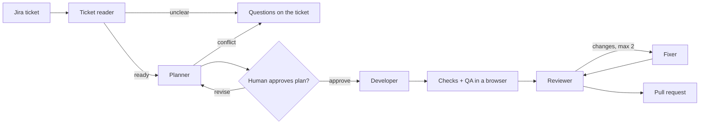

# Agent Dev Team

**A team of AI agents that takes a Jira ticket and delivers a tested, reviewed GitHub pull request.**

You write a ticket the way you would for a developer. The agents read it, ask questions if
it's unclear, study the codebase, plan the work, write the code, test it in a real browser,
review it, and open a PR. A person approves the plan before any code is written, and a
person decides whether to merge.

**Live site:** https://agent-dev-team-jade.vercel.app · **Example PR written by the agents:**
[skher9/agent-playground#1](https://github.com/skher9/agent-playground/pull/1)

> Built by Shravani Kher as a portfolio project. The website is live; the agent backend
> runs locally and is being deployed.

---

## What a run looks like

Ticket **KAN-4: "Add a contact page"**, with six acceptance criteria (form fields, email
validation, a thank-you message, a link from the home page, no backend call).

1. **Ticket reader** checks the ticket is clear enough to build. If not, it posts questions
   on the ticket and stops.
2. **Planner** reads the code and plans the change: create `src/app/contact/page.tsx`,
   modify `src/app/page.tsx`, add tests. It checks the ticket against the code for
   conflicts, and the plan goes on the ticket for a human to **approve, revise or reject**.
3. **Developer** builds each subtask. It can't say "done" until lint, typecheck and the
   unit tests pass, which our code runs, not the model.
4. **Verify:** the whole branch is checked again and scanned for leaked keys and
   placeholder code. Then a **QA agent** writes Playwright tests, one or more per
   acceptance criterion, and runs them against a production build.
5. **Reviewer** reads the diff against the ticket and either approves or lists issues.
   A fixer handles them, up to two rounds, and then the PR opens with a delivery report.

The result for KAN-4: [5 files, 208 lines](https://github.com/skher9/agent-playground/pull/1),
4 unit tests and 5 browser tests, every criterion mapped to a test.

## How it works



The pipeline is a [LangGraph](https://langchain-ai.github.io/langgraph/) graph
([`orchestrator/graph.py`](backend/orchestrator/graph.py)). Agents make decisions; separate
nodes do anything that touches the outside world, like posting to Jira or opening the PR,
so every action is visible in the graph. Pausing for plan approval uses LangGraph's
interrupt with Postgres checkpoints, saved after every step: a run can wait for days for an
answer, and a run that crashes resumes from the last step instead of starting (and paying)
again.

## Design decisions

- **Code checks, models don't grade themselves.** "Done" means lint, typecheck, unit tests
  and browser tests pass, run by our code. The QA agent's report is accepted only if it
  covers every acceptance criterion exactly once.
- **Each agent gets only the tools its job needs.** The ticket reader has none, the planner
  and reviewer can only read, and only the developer can edit. Requests for any other tool
  are refused in code.
- **The agent sees the right files.** Each repo gets a code graph
  ([Graphify](https://pypi.org/project/graphifyy/)), built once and reused. For each
  ticket, a personalized PageRank over that graph ranks the files that matter, like
  Aider's repo map ([`agents/code_map.py`](backend/agents/code_map.py)).
- **It learns from reviews.** When a person leaves review comments on a merged agent PR,
  the learner turns them into short rules ("use the shared Button") that later runs follow
  ([`agents/learner.py`](backend/agents/learner.py)).
- **Every model call goes through one router**, which logs the cost in ₹ and stops a run
  at its budget (₹50 by default). Model IDs live in one file, and a new model must pass the
  eval set first ([`evals/`](backend/evals)).

## Security

- **Sandboxed code.** Everything the agents write runs in a throwaway Docker container:
  non-root, all Linux capabilities dropped, CPU, memory, process and time limits, and a
  network that reaches only the npm registry through a proxy
  ([`services/sandbox.py`](backend/services/sandbox.py)).
- **No secrets in the sandbox.** Containers get no environment variables, and the agents'
  file tools refuse `.env` files and any path outside the repo.
- **Prompt injection.** Ticket text is untrusted, so the agent that reads it has no tools,
  and its output is validated against a schema before anything uses it.
- **Leak scan before every PR** for API keys and private keys
  ([`agents/gate.py`](backend/agents/gate.py)).
- **Humans stay in charge:** plan approval before code, and nothing merges automatically.
- **Website:** email verification, rate-limited login stored in Postgres, CSP and security
  headers, and account deletion.

## Tech

| Part         | What                                                                       |
| ------------ | -------------------------------------------------------------------------- |
| Agents       | Python 3.12, LangGraph, OpenRouter (MiniMax M3, GLM-5.2 as escalation)     |
| API, workers | FastAPI, Celery, Redis                                                     |
| Data         | Postgres on Neon, SQLAlchemy + Alembic, Cloudflare R2 for code graphs      |
| Website      | Next.js 16, React 19, Tailwind CSS v4, Better Auth, Pusher for live events |
| Testing      | pytest (299 tests), Playwright, a golden-ticket eval set                   |
| Integrations | Jira, GitHub                                                               |

## Repo layout

| Folder                      | What lives there                                                |
| --------------------------- | --------------------------------------------------------------- |
| `backend/agents/`           | One file per agent, plus their tools                            |
| `backend/orchestrator/`     | The LangGraph pipeline, run records, plan approval              |
| `backend/llm_router/`       | The only code that calls models: routing, cost logging, budgets |
| `backend/services/`         | Jira, GitHub, sandbox, R2 and workspace clients                 |
| `backend/evals/`            | Golden tickets scored in code after a prompt or model change    |
| `web/`                      | The website: landing page, login, dashboard, run window         |
| `sandbox/`                  | The Docker image agent code runs in, and its npm-only proxy     |
| `templates/nextjs-starter/` | The starter app the agents build on                             |

## Run it locally

Needs Python 3.12 (uv installs it), [uv](https://docs.astral.sh/uv/), Node.js 22+,
pnpm 10.30.1 and Docker Desktop.

```bash
# 1. Secrets: copy the variable names, then fill in real values (never commit these files)
cp .env.example backend/.env        # keep the backend section
cp .env.example web/.env.local      # keep the web section

# 2. Install dependencies
(cd backend && uv sync)
pnpm install

# 3. Local services and the sandbox image
docker compose up -d
docker build -t mas-sandbox -f sandbox/Dockerfile .

# 4. Database (the Neon test branch)
(cd backend && uv run alembic -x target=test upgrade head)

# 5. Run (three terminals)
cd backend && uv run uvicorn api.main:app --reload        # API on :8000
cd backend && uv run celery -A workers.celery_app worker  # background worker
pnpm --filter web dev                                     # website on :3000
```

## Checks

```bash
cd backend && uv run ruff check . && uv run ruff format --check . && uv run pyright && uv run pytest
pnpm format:check && pnpm --filter web lint && pnpm --filter web typecheck
```

CI runs the same checks on every push. Dependabot, CodeQL and GitHub secret scanning
watch the repo.
